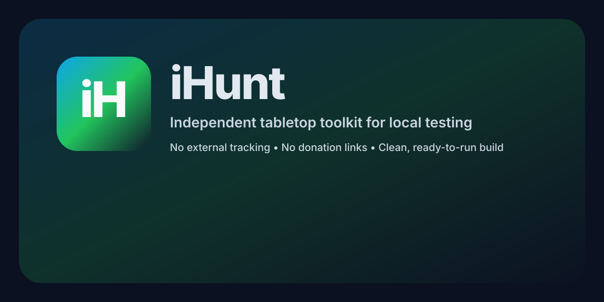

<div align="center">

# 🩸 iHunt App

**Fork independente do [cassApp](https://github.com/cassapp/iHunt-app), a mesa virtual para jogar Fate online, preparado para mesas de #iHunt.**
Versão limpa e autônoma: sem serviços externos, sem links de doação e sem a marca pública original, para testar em privado.




</div>

## 🧭 O que é

O cassApp é uma ferramenta open source para jogar [Fate](https://www.evilhat.com/home/fate-core/) online. Este repositório é um fork mantido pelo [@javaijafoi](https://github.com/javaijafoi), usado como base de testes para mesas de #iHunt, que usa o sistema Fate. Para um celular de mentira com apps do mundo de #iHunt, veja o [iFone](https://github.com/javaijafoi/ifone), e para os outros projetos do Peter, o [portfólio](https://fantasy-portfolio-zeta.vercel.app).

## 🚀 Desenvolvimento

### Pré-requisitos

Node `>=22` (como no campo `engines` do `package.json`) ou o devcontainer do VS Code.

### Instalação e execução

```sh
npm install
npm run start   # http://localhost:1234, com hot reload
```

## 🧱 Tecnologias

React, TypeScript, Vite, Storybook (`stories/`) e testes end-to-end com Cypress (`cypress/`).

## 🤝 Contribuindo e licença

Veja o [CONTRIBUTING](CONTRIBUTING.md) e o [Código de Conduta](CODE_OF_CONDUCT.md). O projeto é distribuído sob a [GNU AGPL-3.0](LICENSE), a mesma licença do projeto original.

---

Crédito ao projeto original: [cassapp/iHunt-app](https://github.com/cassapp/iHunt-app).
